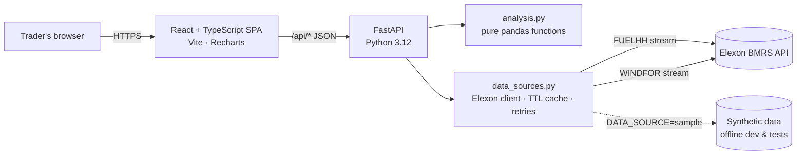

# Wind Forecast Monitor

A web app that helps a UK energy supplier's **day-ahead purchasing team** answer two questions:

1. **What does the latest wind forecast say** for the hours I'm buying power for, using only forecasts that existed when the decision was made?
2. **How much can I trust it?** How large and how biased is the error, how does it grow with lead time, and how much extra power should I buy as a safety margin?

Scope (per the brief): national GB wind generation, Elexon BMRS data only, deliveries in **January 2026**.

**Live app:** `<add your Vercel URL here>`  ·  **Demo video:** `<add your unlisted YouTube URL here>`

---

## Features

| Tab | What it shows |
|---|---|
| **Forecast monitor** | Actual (30-min) vs. forecast wind for any date range. Pick the forecast with a **horizon slider (0–48h)** or the realistic **day-ahead cut-off** (D-1 09:00 UK). Shows hourly error bars, KPIs (MAE, bias, P90 error, % within ±1 GW) and an optional **bias-corrected forecast**. |
| **Accuracy analysis** | Error vs. horizon curve (raw and corrected), error distribution, error by UK hour of day, daily accuracy, and the largest misses with their publish times. Plain-English insights are generated from the numbers. |
| **Day-ahead planner** | Replays a single purchase decision: the forecast available at the cut-off, the bias-corrected plan, a **P10–P90 uncertainty band**, the suggested extra cover (GWh), and an optional "what actually happened" reveal. |

### Key findings (January 2026, live data)

- Forecast error grows steadily with lead time (≈1.8 GW MAE at 0h → ≈2.4 GW at 48h).
- The raw `WINDFOR` forecast is **systematically ~1.6–1.9 GW higher** than metered `FUELHH` output, even at very short lead times. That points to a structural cause, most likely curtailment and constraint actions plus differences in which capacity each dataset covers, rather than weather-forecast skill.
- A **causal** correction (scale by the previous 14 days' actual/forecast ratio, using only data known at decision time) cuts day-ahead MAE by roughly a third (≈2.1 GW → ≈1.4 GW).

The full reasoning is in [`notebooks/analysis.ipynb`](notebooks/analysis.ipynb).

---

## Architecture



- **Frontend** (`frontend/`): React 18 + TypeScript + Vite and Recharts. It has no state library: a small `useApi` hook handles fetching, cancelling and loading state. All formatting is UK-time aware (`Europe/London`).
- **Backend** (`backend/`): FastAPI. A thin HTTP layer (`main.py`) sits over **pure, unit-tested analysis functions** (`analysis.py`) and a pluggable **data source** (`data_sources.py`).
- **Deployment**: one Vercel project serves the static SPA, and the FastAPI app runs as a Python serverless function (`api/index.py`). Docker Compose runs the same stack locally (nginx + uvicorn).

### Core design decisions

| Decision | Why |
|---|---|
| **No hindsight.** For target time `T`, use the *latest forecast with `publish_time ≤ cutoff`*, where `cutoff = T − horizon` or `D-1 09:00 UK`. | It mirrors what a trader actually had. It's implemented with `pandas.merge_asof(..., by="start_time", direction="backward")`, which is vectorised (O(n log n)) with no Python loops. |
| Forecasts **published after** their target time are ignored, and so are forecasts older than 72h. | `WINDFOR` contains "forecasts" for hours already in the past, which would inflate accuracy. |
| Score on the **hourly grid**. | Forecasts are hourly and actuals are half-hourly. Interpolating would invent data, so the :30 actuals are charted but not scored. |
| **Causal bias correction + band.** The scale factor and P10/P90 quantiles come only from hours settled ≥1h before the cut-off, over a trailing 14-day window. | It turns the analysis into an honest back-test that the team could run in production. Unit tests "poison" future data to prove nothing leaks. |
| Error = `forecast − actual`. | Positive means wind was over-forecast, so the team under-bought and needs extra cover. The sign convention is the same everywhere. |
| **One cached upstream call per dataset.** | January's data never changes. A TTL cache plus fetching the whole window once keeps every UI interaction under a second after warm-up and is gentle on Elexon. It retries with exponential backoff. |
| **`DATA_SOURCE=sample`** | Deterministic synthetic data with the real schema and cadence. Tests and offline development never depend on the network. |

---

## Running locally

### Option A: Docker (recommended)

```bash
docker compose up --build
# app:  http://localhost:8080
# API:  http://localhost:8000/api/docs  (Swagger UI)
```

To run fully offline: `DATA_SOURCE=sample docker compose up --build`

### Option B: without Docker

```bash
# backend
cd backend
python -m venv .venv && source .venv/bin/activate
pip install -r requirements-dev.txt
uvicorn app.main:app --reload --port 8000

# frontend (new terminal)
cd frontend
npm install
npm run dev            # http://localhost:5173 (proxies /api to :8000)
```

### Tests & quality

```bash
cd backend  && pytest -q && ruff check app tests     # 27 tests: selection rules, DST, causality, API, retries
cd frontend && npm run typecheck && npm test && npm run build
```

GitHub Actions (`.github/workflows/ci.yml`) runs lint, tests, type-check, build and a Docker build on every push.

---

## API

Interactive docs are at `/api/docs`. All times are UTC ISO-8601.

| Endpoint | Purpose |
|---|---|
| `GET /api/health` | Liveness and the active data source |
| `GET /api/meta` | Window, cut-off and correction settings |
| `GET /api/series?start&end&mode=horizon\|decision&horizon_h=0..48` | Chart data: 30-min actuals plus the applicable hourly forecast (raw and corrected), with metrics |
| `GET /api/analysis?start&end&mode&horizon_h` | Horizon curve, distributions, hour-of-day, daily, worst misses (one round-trip) |
| `GET /api/day-ahead?delivery_date=YYYY-MM-DD` | Decision replay: cut-off, forecast used, corrected plan, P10–P90 band, energy summary |

Configuration (environment variables): `DATA_SOURCE` (`elexon`\|`sample`), `DECISION_CUTOFF` (default `09:00` UK), `CORRECTION_DAYS` (default `14`), `WINDOW_START`/`WINDOW_END`, `CACHE_TTL_S`, `CORS_ORIGINS`.

---

## Project structure

```
.
├── api/index.py               # Vercel serverless entry -> backend/app/main.py
├── backend/
│   ├── app/
│   │   ├── main.py            # FastAPI routes (thin)
│   │   ├── analysis.py        # forecast selection, metrics, correction (pure functions)
│   │   ├── data_sources.py    # Elexon client, cache, retries, synthetic source
│   │   └── config.py          # env-driven settings
│   ├── tests/                 # pytest: unit + API tests (offline)
│   ├── Dockerfile
│   └── requirements*.txt
├── frontend/
│   ├── src/
│   │   ├── App.tsx            # layout + tabs
│   │   ├── components/        # MonitorView, AccuracyView, DayAheadView, Controls, ui
│   │   ├── api.ts, types.ts   # typed API client
│   │   ├── format.ts          # UK-time + unit formatting (unit tested)
│   │   └── useApi.ts          # fetch hook with abort/cancel
│   ├── Dockerfile, nginx.conf
│   └── vite.config.ts
├── notebooks/analysis.ipynb   # analysis behind the findings (generated by build_notebook.py)
├── docker-compose.yml
├── vercel.json
└── .github/workflows/ci.yml
```

---

## Deploying to Vercel

1. Push this repo to GitHub.
2. In Vercel, **Add New → Project** and import the repo. Keep the root directory as `/`; `vercel.json` already sets the build, the output and the Python function.
3. Deploy. The SPA is served from `frontend/dist`, and `/api/*` is routed to the FastAPI function (`maxDuration` 60s for the first cold fetch from Elexon).

---

## Assumptions & limitations

- The decision cut-off is assumed to be **D-1 09:00 UK time** (before the GB day-ahead auctions). It can be changed with `DECISION_CUTOFF`.
- National level only, with no regional split. `FUELHH` WIND is transmission-metered output, and the bias analysis suggests it is not like-for-like with `WINDFOR` (curtailment and embedded capacity). Explaining this would need extra datasets (BOAs, constraint volumes), which are outside the brief.
- The daily "low case" sums hourly P10 values. This is deliberately conservative: hourly errors are correlated, but not perfectly.
- The in-memory cache is per serverless instance. For a production rollout I'd add a shared cache (Redis) or a nightly ETL into Postgres.

## Next steps

Regional (Scotland vs. England) analysis, curtailment data to explain the bias, a probabilistic model (quantile regression on lead time, hour and wind level), alerting when a new forecast moves the plan by more than X GW, and authentication for client users.

## Use of AI tools

AI coding assistants (Claude) were used for scaffolding, boilerplate and documentation drafts. All design decisions, analysis logic and test cases were reviewed, run and verified by me.
